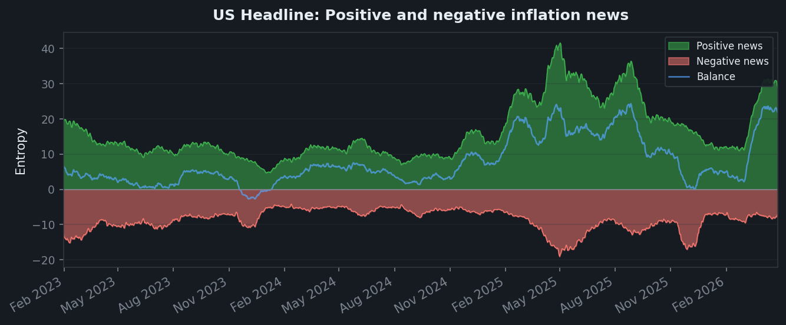
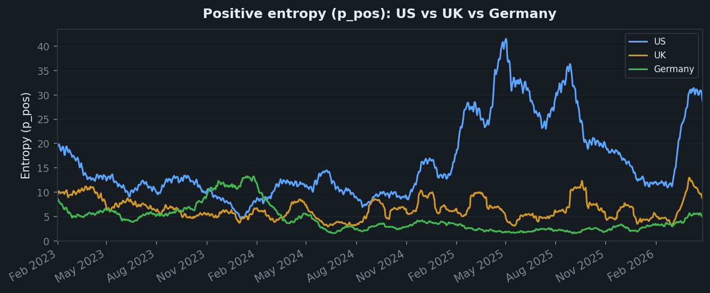
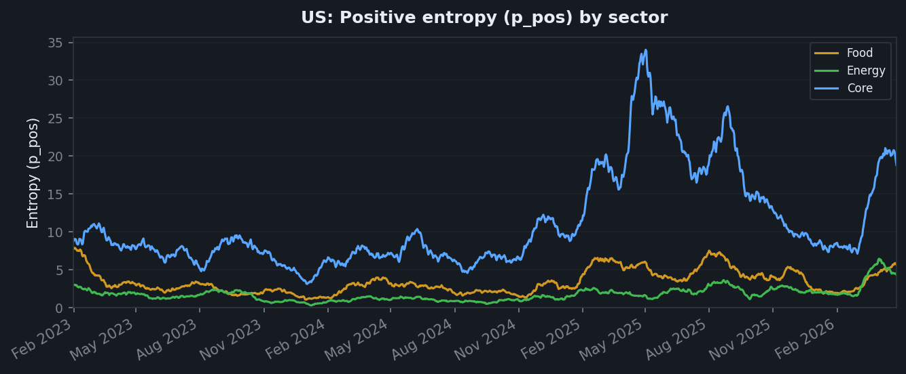
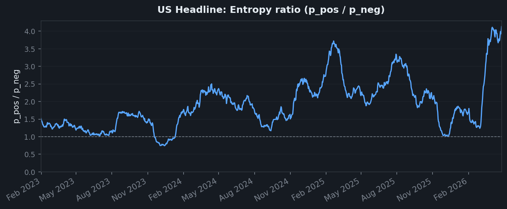
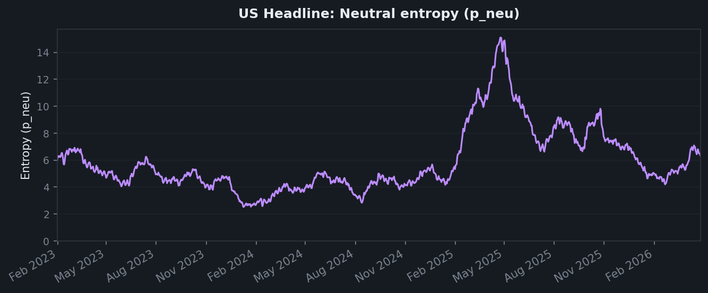
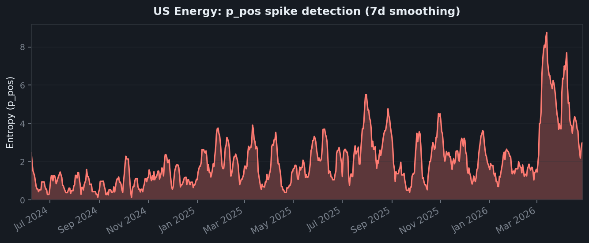
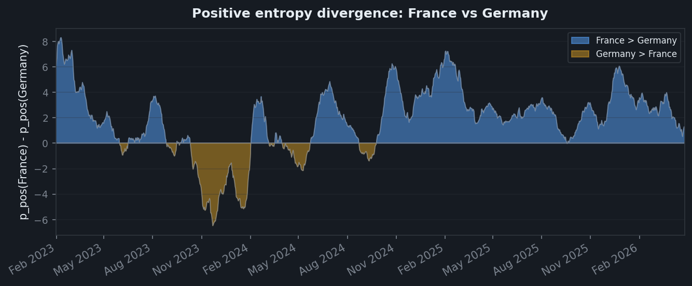
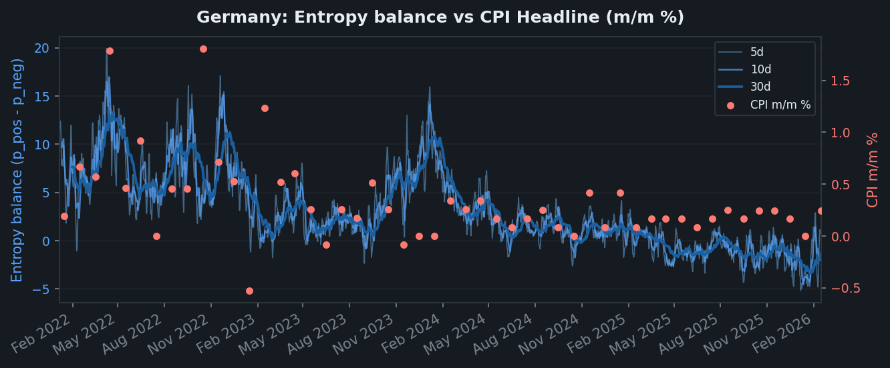

# Use cases

## [`/nipi`](../api-reference/endpoints/nipi.md) | Entropy metric

> The **NIPI** (News Inflation Pressure Index) is a daily diffusion index
> that measures inflation pressures from real-time news analysis. It is
> constructed from positive and negative news signals, smoothed over a
> 30-day rolling window. The **Entropy** metric provides access to these
> underlying components: for each date, the API returns `p_pos` (sum of
> probabilities that news signal upward price pressure), `p_neg` (sum of
> probabilities that news signal downward price pressure), and `p_neu`
> (neutral). Unlike the NIPI, Entropy values are not smoothed. Set
> `metric` to `Entropy` to retrieve them.
>
> Below are practical examples of how to query and use these components.

---

### Setup

All examples below use the [`ams-sdk`](../sdk/python/ams-sdk.md) Python
package. The Entropy metric is accessed through the same `/nipi` endpoint
by setting `metric` to `Entropy`.

```python
from ams_sdk.client import AMSClient
import pandas as pd

client = AMSClient(service_url=SERVICE_URL, api_key=API_KEY)
client.authenticate()

# Retrieve Entropy for US Headline
result = client.query_endpoint("/nipi", params={
    "location": "US",
    "sector": "Headline",
    "metric": "Entropy",
    "start": "2023-01-01"
})

df = pd.DataFrame(result.get('content'))
df['date'] = pd.to_datetime(df['date'])
df['sign'] = df['meta'].apply(lambda x: x['metric_2'])
df = df.set_index('date')

# Filter by component
pos = df[df['sign'] == 'p_pos']['value']
neg = df[df['sign'] == 'p_neg']['value']
neu = df[df['sign'] == 'p_neu']['value']
```

---

### Inflation pressure balance

Plot `p_pos` and `p_neg` together to visualize the balance between upward
and downward inflation news signals. When the positive area dominates, news
flow signals rising price pressures.

```python
pos.plot(label='p_pos')
neg.plot(label='p_neg')
```

<details>
<summary>Show chart</summary>



*US Headline: positive (green) vs negative (red) entropy, with balance
(blue). Data from the AMS API.*

</details>

---

### Cross-country comparison (positive entropy)

Compare `p_pos` across countries to identify where upward inflation
pressure is strongest. The same `location` parameter used for the NIPI
applies here.

```python
countries = ["US", "UK", "Germany"]

for c in countries:
    result = client.query_endpoint("/nipi", params={
        "location": c,
        "sector": "Headline",
        "metric": "Entropy",
        "start": "2023-01-01"
    })
    df = pd.DataFrame(result.get('content'))
    df['date'] = pd.to_datetime(df['date'])
    df['sign'] = df['meta'].apply(lambda x: x['metric_2'])
    df = df.set_index('date')
    pos = df[df['sign'] == 'p_pos']['value']
    pos.plot(label=c)
```

<details>
<summary>Show chart</summary>



*Positive entropy (p_pos) for US, UK, and Germany. Data from the AMS API.*

</details>

---

### Sector breakdown (positive entropy)

Use the `sector` parameter to compare `p_pos` across sectors for a single
country. This reveals which component (Food, Energy, Core) is contributing
most to upward price pressure.

```python
sectors = ["Food", "Energy", "Core"]

for s in sectors:
    result = client.query_endpoint("/nipi", params={
        "location": "US",
        "sector": s,
        "metric": "Entropy",
        "start": "2023-01-01"
    })
    df = pd.DataFrame(result.get('content'))
    df['date'] = pd.to_datetime(df['date'])
    df['sign'] = df['meta'].apply(lambda x: x['metric_2'])
    df = df.set_index('date')
    pos = df[df['sign'] == 'p_pos']['value']
    pos.plot(label=s)
```

<details>
<summary>Show chart</summary>



*US positive entropy (p_pos) by sector. Data from the AMS API.*

</details>

---

### Entropy ratio

Divide `p_pos` by `p_neg` to get a single ratio that summarizes the
signals balance. A ratio above 1 means positive signal dominates; below 1,
negative dominates. The ratio normalizes for news volume, making it
possible to compare countries with very different levels of media coverage
on an equal footing.

```python
ratio = pos / neg
ratio.plot(title='p_pos / p_neg')
```

<details>
<summary>Show chart</summary>



*US Headline: entropy ratio (p_pos / p_neg). Dashed line at 1.0. Data
from the AMS API.*

</details>

---

### Neutral component

The `p_neu` component captures inflation news with no clear directional
signal. Tracking it over time can reveal shifts in overall news attention
to inflation, independent of direction.

```python
neu = df[df['sign'] == 'p_neu']['value']
neu.plot(title='Neutral entropy')
```

<details>
<summary>Show chart</summary>



*US Headline: neutral entropy (p_neu). Data from the AMS API.*

</details>

---

### Event detection

Zoom into a specific sector and time window to detect sudden spikes in
positive signal. A shorter smoothing window (7 days instead of 30) makes
spikes more visible.

```python
result = client.query_endpoint("/nipi", params={
    "location": "US",
    "sector": "Energy",
    "metric": "Entropy",
    "start": "2024-06-01"
})

# 7-day smoothing for spike detection
pos = df[df['sign'] == 'p_pos']['value'].rolling(7).mean()
```

<details>
<summary>Show chart</summary>



*US Energy: p_pos with 7-day smoothing. Data from the AMS API.*

</details>

---

### Country divergence

Subtract `p_pos` of one country from another to highlight periods where
inflation pressure diverges. Blue areas indicate stronger French signal,
orange areas indicate stronger German signal.

```python
# p_pos for France and Germany
pos_fr = ...  # filtered from France query
pos_de = ...  # filtered from Germany query

divergence = pos_fr - pos_de
divergence.plot(title='p_pos divergence: France vs Germany')
```

<details>
<summary>Show chart</summary>



*Positive entropy divergence: France minus Germany. Data from the AMS API.*

</details>

---

### Entropy balance vs CPI

Overlay the Entropy balance (`p_pos - p_neg`) with official CPI releases
to see how the news-based signal relates to published inflation data. The
CPI is shifted by 1.5 months to reflect its publication lag.

```python
# Entropy balance for Germany
result = client.query_endpoint("/nipi", params={
    "location": "Germany",
    "sector": "Headline",
    "metric": "Entropy",
    "start": "2022-01-01"
})

# CPI from Macrobond (index, converted to m/m %)
from macrobond_data_api.web import WebClient
mb = WebClient(client_id, client_secret)
with mb as api:
    cpi = api.get_one_series("oecd_mei_00530903")
```

<details>
<summary>Show chart</summary>



*Germany: Entropy balance with 5d, 10d, and 30d smoothing (blue, left
axis) vs CPI Headline m/m % (red dots, right axis). Data from the AMS API and OECD.*

</details>

---

### More resources

- &#x1F517; [Blog](https://alt.ms/blog) for historical illustrations and
  extended case studies.
- [`/nipi` endpoint reference](../api-reference/endpoints/nipi.md)
- [NIPI use cases](nipi-use-cases.md)
- [`/nbstat` use cases](nbstat-implementation.md)
- [Python SDK](../sdk/python/ams-sdk.md)
