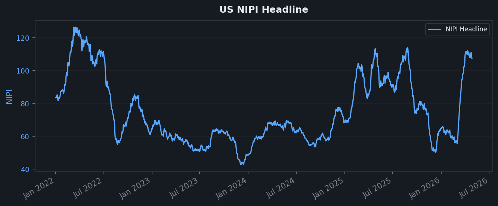
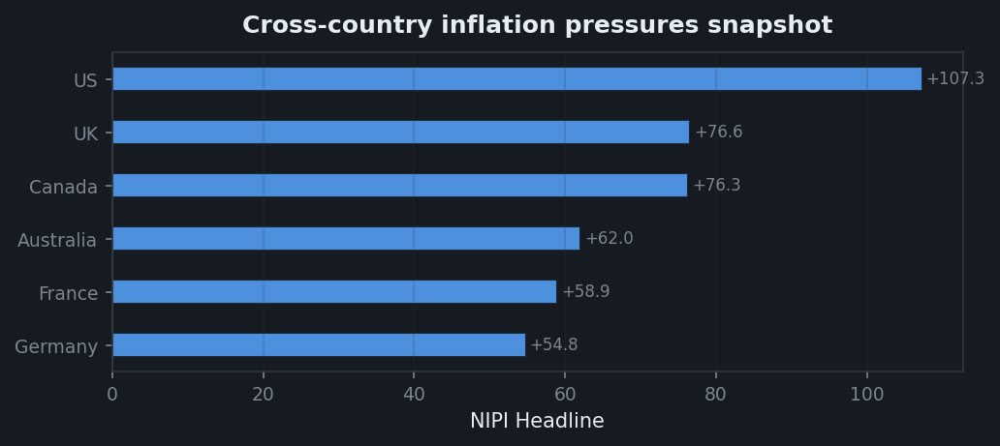
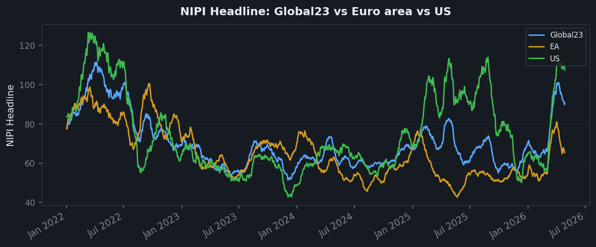
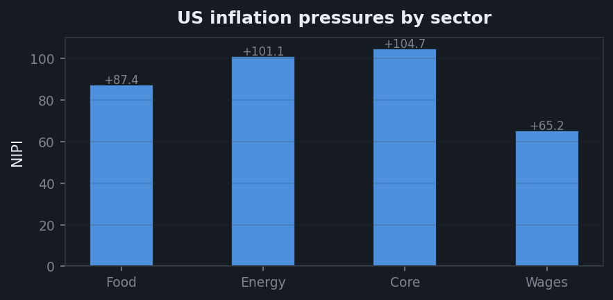
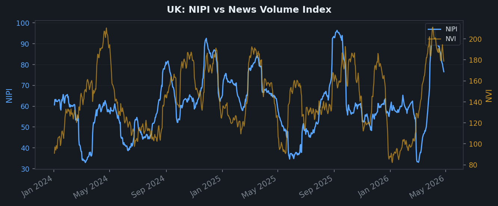

# Use cases

## [`/nipi`](../api-reference/endpoints/nipi.md)

> The **NIPI** (News Inflation Pressure Index) is a daily diffusion index
> that measures inflation pressures from real-time news analysis. It covers
> 23 economies and 7 sector breakdowns.
>
> Below are practical examples of how to use the `/nipi` endpoint in your
> workflow.

---

### Setup

All examples below use the [`ams-sdk`](../sdk/python/ams-sdk.md) Python
package, a wrapper around the AMS API that handles authentication and
queries in a few lines.

```bash
pip install ams-sdk
```

```python
from ams_sdk.client import AMSClient

client = AMSClient(service_url=SERVICE_URL, api_key=API_KEY)
client.authenticate()
```

Query any endpoint with `client.query_endpoint()` and convert the result
to a Pandas DataFrame:

```python
result = client.query_endpoint("/nipi", params={
    "location": "China",
    "sector": "Food"
})

df = pd.DataFrame(result.get('content'))
df['date'] = pd.to_datetime(df['date'])
df = df.set_index('date')
df.sort_index(inplace=True)
```

See the [SDK documentation](../sdk/python/ams-sdk.md) and the
[`/nipi` endpoint reference](../api-reference/endpoints/nipi.md) for the
full list of parameters.

---

### Real-time inflation monitor

Specify a `location`, a `sector`, and optionally a date range with `start`
and `end` to retrieve a time series.

```python
result = client.query_endpoint("/nipi", params={
    "location": "US",
    "sector": "Headline",
    "start": "2024-01-01"
})
```

Convert to a Pandas DataFrame and plot:

```python
import pandas as pd

df = pd.DataFrame(result.get('content'))
df['date'] = pd.to_datetime(df['date'])
df = df.set_index('date')
df.sort_index(inplace=True)

df['value'].plot(title='US NIPI Headline')
```

<details>
<summary>Show chart</summary>



*US NIPI Headline. Data from the AMS API.*

</details>

---

### Cross-country comparison

Query multiple countries in a single loop to get a real-time cross-country
snapshot of inflation pressures, all built on the same methodology.

```python
countries = ["US", "UK", "Germany", "Australia", "Canada", "France"]
data = {}

for c in countries:
    result = client.query_endpoint("/nipi", params={
        "location": c,
        "sector": "Headline",
        "start": "2026-03-01"
    })
    df = pd.DataFrame(result.get('content'))
    df['date'] = pd.to_datetime(df['date'])
    df = df.set_index('date')
    data[c] = df['value'].iloc[-1]

# Rank countries by latest NIPI reading
ranking = pd.Series(data).sort_values(ascending=False)
print(ranking)
```

<details>
<summary>Show chart</summary>



*NIPI Headline by country. Live data from the AMS API.*

</details>

---

### Regional aggregates

Beyond individual countries, the NIPI also covers regional aggregates such
as `Global23` and `EA` (Euro area). Plot them side by side to compare
inflation dynamics across regions.

```python
regions = ["Global23", "EA", "US"]

for r in regions:
    result = client.query_endpoint("/nipi", params={
        "location": r,
        "sector": "Headline",
        "start": "2022-01-01"
    })
    df = pd.DataFrame(result.get('content'))
    df['date'] = pd.to_datetime(df['date'])
    df = df.set_index('date')
    df['value'].plot(label=r)
```

<details>
<summary>Show chart</summary>



*NIPI Headline for Global23, Euro area, and US. Live data from the AMS API.*

</details>

---

### Sector decomposition

Use the `sector` parameter to identify which component is driving inflation
pressures.

```python
sectors = ["Food", "Energy", "Core", "Wages"]

for s in sectors:
    result = client.query_endpoint("/nipi", params={
        "location": "US",
        "sector": s,
        "start": "2026-03-01"
    })
    df = pd.DataFrame(result.get('content'))
    df['date'] = pd.to_datetime(df['date'])
    df = df.set_index('date')
    latest = df['value'].iloc[-1]
    print(f"{s}: {latest:+.3f}")
```

This helps answer: are current pressures broad-based, or concentrated in
food? energy? wages?

<details>
<summary>Show chart</summary>



*NIPI by sector. Live data from the AMS API.*

</details>

---

### NIPI vs News Volume Index

The `metric` parameter gives access to the `NVI` (News Volume Index), which
tracks the volume of inflation-related news. Plot it alongside the NIPI to
see whether inflation pressure coincides with heightened media attention.

```python
# NIPI and NVI for the UK
nipi = client.query_endpoint("/nipi", params={
    "location": "UK",
    "sector": "Headline",
    "start": "2024-01-01"
})

nvi = client.query_endpoint("/nipi", params={
    "location": "UK",
    "sector": "Headline",
    "metric": "NVI",
    "start": "2024-01-01"
})
```

<details>
<summary>Show chart</summary>



*UK: NIPI (blue, left axis) vs News Volume Index (orange, right axis).
Data from the AMS API.*

</details>

---

### More resources

- &#x1F517; [Blog](https://alt.ms/blog) for historical illustrations and
  extended case studies.
- [`/nipi` endpoint reference](../api-reference/endpoints/nipi.md)
- [`/nbstat` use cases](use-cases.md)
- [Python SDK](../sdk/python/ams-sdk.md)
